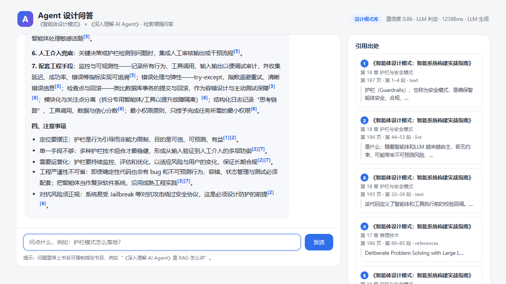

# 「Agent 设计」问答 Agent

基于两本 PDF 书籍（《智能体设计模式》《深入理解 AI Agent》）的检索增强问答服务：
**PDF 解析 → 数据清洗 → 结构化切片 → Embedding → Milvus 混合检索 → 意图路由 → 双库 Agent → 强制引用审计**。

> 设计基线见 [docs/DESIGN.md](docs/DESIGN.md)，入库报告见 [docs/INGEST_REPORT.md](docs/INGEST_REPORT.md)。

## 实测结果

| 指标 | 结果 |
|---|---|
| 入库 | 618 页 → **1289 个切片**（design 399 / deep 890），真实 `text-embedding-v4` 1024 维，Milvus 行数 1289 |
| 页码可溯源 | 随机 120 条抽检：精确 95.0%，**页码偏移 0**（其余为图内文字/代码行号口径） |
| 意图路由 | 真实 LLM 15 条用例 **15/15 = 100%**（含 3 条显式指定/双库） |
| 问答引用 | 5/5 通过，引用与召回一一对应，平均 13.9s（推理模型） |
| 单元测试 | `pytest` **200 passed**（2026-10-27） |
| 一键验收 | `python scripts/acceptance.py` → 5/5 项通过 |



详细数据与审计日志样例见 [docs/ACCEPTANCE.md](docs/ACCEPTANCE.md)。

## 能力概览

| 能力 | 说明 |
|---|---|
| 数据清洗 | 目录页、页眉页脚、代码行号、硬换行、连字符、参考文献等 10 类规则，全部可单测 |
| 结构化切片 | 每块携带 书 / 章号+章名 / 节 / **印刷页码** / 章内段号 / 类型（正文·代码·列表） |
| 混合检索 | Milvus 2.6：HNSW(余弦) 稠密向量 + 中文 BM25 稀疏向量，RRF 融合，同章去重 + 相邻块扩展 |
| 意图路由 | 显式指令 > LLM 结构化判定 > 关键词规则兜底；低置信自动转双库并给澄清提示 |
| 双库 Agent | 设计模式 Agent（怎么做）/ 深入理解 Agent（为什么）/ 双库对比 Agent |
| 引用审计 | 正文 `[n]` + 末尾出处；每次回复在控制台与 `logs/answers-*.jsonl` 打印 书·章·页·段·原文 |
| 无 key 可跑 | 未配置 LLM → 规则路由 + 检索摘要作答；未配置 Embedding → `EMBEDDING_MOCK=1` 桩向量跑通链路 |

## 快速开始

```powershell
# 1. 依赖（项目内已带 .venv，可直接用）
.\.venv\Scripts\python.exe -m pip install -r requirements.txt

# 2. 配置
copy .env.example .env
#   填入 EMBEDDING_API_KEY（阿里云百炼 DashScope）
#   填入 LLM_API_KEY / LLM_BASE_URL / LLM_MODEL（DeepSeek 或任意 OpenAI 兼容端点）

# 3. 自检
.\.venv\Scripts\python.exe -m app.cli check

# 4. 离线入库（约 1–3 分钟，视 Embedding 速率）
.\.venv\Scripts\python.exe -m app.cli ingest

# 5. 命令行问答
.\.venv\Scripts\python.exe -m app.cli ask "提示链模式适合什么场景？"

# 6. 启动 Web 服务 -> http://127.0.0.1:8000
.\.venv\Scripts\python.exe -m app.cli serve

# 7. 一键验收（配置/入库/页码/路由/问答引用）
.\.venv\Scripts\python.exe scripts\acceptance.py
```

## 部署到服务器

完整步骤见 [docs/DEPLOY.md](docs/DEPLOY.md)（Docker Compose / systemd 两种路线、nginx + HTTPS、运维与安全清单）。

```bash
# 服务器上（Docker 路线）
cp .env.example .env && chmod 600 .env && vi .env      # 填 key、ADMIN_API_KEY、Milvus
scp 本机:data/chunks.jsonl ./data/                     # Milvus 共享时只需切片清单
docker compose up -d --build
docker compose run --rm app check
curl -s http://127.0.0.1:8000/api/health
```

关键约定：应用只监听 `127.0.0.1:8000`，公网走 nginx 80/443；PDF 不需要上传（除非在服务器重新入库）；`.env` 不进镜像。
服务器无法拉镜像时，可本机 `docker save` 后 `docker load` 离线交付（见部署文档 4.6）。

**前端访问方式**：没有独立前端服务、没有构建步骤——`web/` 是原生单页，前端资源与 API 都用**相对路径**，
所以可以挂在根域名、子域名或子路径：

| 访问方式 | 示例 | nginx 配置 |
|---|---|---|
| 子域名（推荐） | `https://agent.<YOUR_DOMAIN>/` | [deploy/nginx.panel-site.conf](deploy/nginx.panel-site.conf) |
| 根域名子路径 | `https://<YOUR_DOMAIN>/agent-book/` | [deploy/nginx.subpath-agent-book.conf](deploy/nginx.subpath-agent-book.conf) |
| 独立 nginx 整站反代 | `https://qa.example.com/` | [deploy/nginx.domain.conf](deploy/nginx.domain.conf) |

详见 [docs/DEPLOY.md](docs/DEPLOY.md) 4.4.1 / 4.4.2 / 4.4.3。

## 配置项（.env）

| 变量 | 说明 | 默认 |
|---|---|---|
| `EMBEDDING_API_KEY` | DashScope Key（必填，或开 mock） | 空 |
| `EMBEDDING_BASE_URL` | OpenAI 兼容 embedding 端点 | `https://dashscope.aliyuncs.com/compatible-mode/v1` |
| `EMBEDDING_MODEL` / `EMBEDDING_DIMENSION` | 模型与维度 | `text-embedding-v4` / `1024` |
| `EMBEDDING_MOCK` | 无 key 时用确定性桩向量（仅调试） | `0` |
| `SYMBOL_AGENT_MILVUS_URI` / `SYMBOL_AGENT_MILVUS_TOKEN` | Milvus 连接 | 见 `.env.example` |
| `MILVUS_COLLECTION` | 本项目集合名 | `agent_design_kb` |
| `ADMIN_API_KEY` | 后台入库 Bearer token；留空则关闭管理接口 | 空 |
| `LLM_API_KEY` / `LLM_BASE_URL` / `LLM_MODEL` | 路由与答案生成 | 空 / `https://api.deepseek.com` / `deepseek-chat` |
| `LLM_MAX_TOKENS` / `LLM_ROUTER_MAX_TOKENS` | 生成/路由 token 上限（推理模型需 ≥2048） | `2048` |
| `RAG_TOP_K` | 召回条数 | `8` |

## 入库与索引安全

- 普通入库使用幂等 upsert，并在全部新批次成功后清理所选书目的旧 chunk ID；分批写入期间不具备原子可见性。
- `--recreate` 会先写入独立的 `<collection>_v_<id>` staging collection，校验行数后再切换公开 alias，不再先删除旧索引。
- 单书重建会复制另一本书的原始行和向量；旧版本 collection 会保留用于恢复，不会自动删除。
- 对占用公开名称的旧版物理 collection，重建时先改名为 `<collection>_legacy_<id>` 再建立公开 alias；alias 创建失败会恢复旧名称。备份及历史版本需确认空间与恢复策略后由运维手动清理。
- 正式 Milvus 更新成功后才提交 `data/chunks.jsonl`，避免写入失败造成本地快照与索引不一致；dry-run 不写 Milvus。
- `EMBEDDING_MOCK=1` 仅用于 dry-run/离线调试，不能写正式 collection，也不能用桩向量查询正式索引。

```powershell
# 增量入库（默认）
.\.venv\Scripts\python.exe -m app.cli ingest

# staging 重建并切换 alias（会保留旧版本）
.\.venv\Scripts\python.exe -m app.cli ingest --recreate
```

## HTTP 接口

| 方法 | 路径 | 说明 |
|---|---|---|
| POST | `/api/chat` | 问答，返回 `answer / citations / route / latency_ms` |
| POST | `/api/chat/stream` | SSE：`meta` → `sources` → 多个 `token` → `done` |
| POST | `/api/search` | 只检索（验证召回） |
| GET | `/api/health` | 服务 / Milvus / 配置自检 |
| GET | `/api/stats` | 集合行数、各书章节块数 |
| GET | `/api/books` | 两本书章节目录树 |
| POST | `/api/admin/ingest` | 后台重建索引，需 `Authorization: Bearer <ADMIN_API_KEY>` |
| GET | `/api/admin/ingest/{job_id}` | 入库任务状态，需同样的 Bearer token |

## 目录结构

```
app/
  config.py models.py logging_conf.py main.py cli.py
  api/      chat search admin health deps
  ingest/   extract clean chunk embed milvus_store pipeline
  rag/      llm router retriever agents citations
web/        index.html app.js styles.css
docs/       DESIGN.md DEPLOY.md INGEST_REPORT.md ACCEPTANCE.md ui-demo.png
scripts/    acceptance.py
deploy/     nginx.conf entrypoint.sh agent-design.service
data/       pages/*.jsonl chunks.jsonl embed_cache.sqlite3
logs/       answers-YYYYMMDD.jsonl
tests/
Dockerfile  docker-compose.yml  docker-compose.nginx.yml  .dockerignore
```

## 测试

```powershell
.\.venv\Scripts\python.exe -m pytest tests -q
```

## 引用与审计示例

```
[ANSWER] id=20261027-153001-8f3a route=design intent=concept conf=0.86 src=llm ms=1842 model=deepseek-chat
[引用 1] 《智能体设计模式：智能系统构建实战指南》第 5 章 工具使用（函数调用） · 第 67 页 · 第 3 段
         原文：“工具使用模式让模型在推理过程中调用外部函数……”
```

## 安全说明

- Milvus 使用独立 collection `agent_design_kb`，**不触碰**同实例上的其他项目集合。
- 连接串与 token 只从 `.env` 读取，不写入前端、不回显完整密钥。
- 生产环境建议把 Milvus 收到内网并使用独立最小权限账号。

## 敏感信息与提交规范

仓库**禁止**提交 API key、服务器地址（IP/端口）、自有域名、数据库凭据、私钥与运行产物：

- 配置只放本地 `.env`（已忽略），模板见 [.env.example](.env.example)，用 `<...>` 占位符；
- 已内置提交前扫描：`scripts/check_secrets.py`（pre-commit + CI）；
- 启用钩子（每个克隆一次）：
  ```bash
  sh scripts/install_git_hooks.sh            # Linux/macOS/Git Bash
  pwsh scripts/install_git_hooks.ps1         # Windows
  ```
- 手工自检：`python scripts/check_secrets.py --all`
- 误报在该行加 `secret-scan: allow`；
- **已泄漏过的凭据必须先轮换，再清理历史**，完整流程（含历史重写命令）见 [docs/SECRETS.md](docs/SECRETS.md)。

> 提醒：仓库历史中若曾出现真实地址/口令，即使现在删了文件也仍然留在 Git 历史里；
> 必须按 docs/SECRETS.md 清理历史并轮换凭据。

